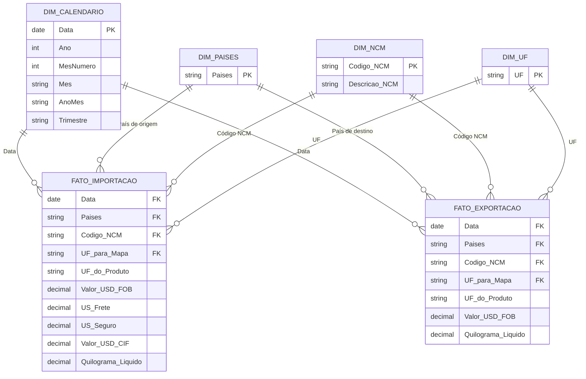

# Green Tea Analytics: Análise do Comércio Exterior Brasileiro de Chá Verde (2010–2024)

## Sobre o projeto

O Green Tea Analytics é um projeto de análise de dados desenvolvido em Power BI para investigar o comportamento do comércio exterior brasileiro de chá verde entre 2010 e 2024.

A partir de dados públicos do Comex Stat, são analisadas as operações de importação e exportação, considerando valores financeiros, volumes negociados, países parceiros, distribuição geográfica e custos associados às importações.

O objetivo é transformar dados de comércio exterior em indicadores e informações que permitam compreender a dinâmica comercial do produto, identificar tendências e avaliar a evolução dos valores negociados.

## Objetivo e perguntas de negócio

O projeto busca responder às seguintes perguntas:

- Como evoluíram as importações e exportações brasileiras de chá verde?
- Quais são os principais países de origem das importações e destinos das exportações?
- Como as operações estão distribuídas entre os estados brasileiros?
- Como evoluíram os valores negociados por quilograma?
- Qual é a participação do frete e do seguro no valor total das importações?

## Escopo e fonte dos dados

Os dados foram obtidos no Comex Stat, plataforma oficial de estatísticas de comércio exterior do Ministério do Desenvolvimento, Indústria, Comércio e Serviços (MDIC).

Período analisado: janeiro de 2010 a dezembro de 2024.

Classificações NCM utilizadas:

| Código NCM | Descrição| 
| ---- | ---- |
| 09021000 | Chá verde não fermentado em embalagens imediatas de conteúdo não superior a 3 kg |
| 09022000 | Chá verde não fermentado apresentado de qualquer outra forma |


**Principais variáveis:**

* Ano e mês da operação;
* Países parceiros;
* UF do produto;
* Código e descrição NCM;
* Valor US$ FOB;
* Quilograma líquido;
* US$ Frete e US$ Seguro;
* Valor US$ CIF (importações).
* Estrutura do dashboard

## Estrutura do dashboard

O dashboard foi organizado em três páginas analíticas:

### 1. Visão Geral

Apresenta um panorama do comércio exterior brasileiro de chá verde, permitindo comparar os fluxos de importação e exportação.

[](/imagens/visao_geral.png)


### 2. Mercados e Distribuição Geográfica

Investiga a distribuição geográfica das operações e a participação dos principais parceiros comerciais.

[](/imagens/mercado_distribuicao.png)

### 3. Valores Unitários e Custos

Analisa a evolução dos valores negociados por quilograma e a composição dos custos adicionais nas importações.

[](/imagens/valores_unitarios_custos.png)

Os painéis possuem filtros interativos por ano, NCM e país parceiro.

### Acesso ao dashboard

O dashboard interativo pode ser acessado pelo Power BI:

[**Visualizar Green Tea Analytics**](https://app.powerbi.com/view?r=eyJrIjoiZTU2ZDc1YWItZDc5ZS00YTVjLTliOGQtNWRmYmMyYjY1N2VlIiwidCI6IjU3NTI5OTdmLTBkODUtNDI0My04ZjgxLTNiYmZlMTI5ODhjYiJ9&pageName=161d13517e3051140f5e)


## Metodologia e modelagem de dados

O projeto utiliza um modelo dimensional com duas tabelas fato independentes:

- `fato_importacao`;
- `fato_exportacao`.

As tabelas compartilham dimensões de calendário, países, NCM e unidades federativas, permitindo análises integradas sem relacionar diretamente as tabelas fato.



**Como interpretar o diagrama:**
- Cada dimensão possui relacionamento 1:N com as duas tabelas fato.
- `DIM_PAISES` representa países de origem nas importações e países de destino nas exportações.
- `UF_para_Mapa` permite relacionar somente unidades federativas brasileiras válidas à dimensão `DIM_UF`.
- `UF_do_Produto` preserva a informação original, inclusive categorias que não representam estados.
- A tabela de importações contém frete, seguro e valor CIF; esses campos não existem na tabela de exportações.

O tratamento e a preparação dos dados são realizados no Power Query, utilizando linguagem M. As medidas e os indicadores analíticos são desenvolvidos em DAX.

**Principais cálculos:**

| Indicador | Cálculo |
|---|---|
| Saldo comercial | Exportações FOB − Importações FOB |
| FOB/kg importado | FOB importado ÷ kg importado |
| FOB/kg exportado | FOB exportado ÷ kg exportado |
| CIF/kg importado | CIF importado ÷ kg importado |
| Frete/CIF | Frete ÷ CIF |
| Seguro/CIF | Seguro ÷ CIF |

Os valores unitários são calculados pela razão entre o valor financeiro total e o peso líquido total, considerando a ponderação pelo volume negociado.

## Tecnologias utilizadas

- **Power BI:** modelagem, indicadores e visualização de dados;
- **Power Query (M):** tratamento e transformação dos dados;
- **DAX:** criação de medidas e cálculos analíticos;
- **Python:** análise exploratória e validação dos dados;
- **Git e GitHub:** versionamento e documentação do projeto.


## Organização do Repositório
```
├── dados/
|   ├── exportacao_2010_2024.csv
|   └── importacao_2010_2024.csv
├── imagens/
|   ├── mercado_distribuicao.png
|   ├── valores_unitarios_custos.png
│   └── visao_geral.png
├── notebooks/
│   └── analise_exploratoria.ipynb
├── power_BI/
|   ├── dashboard_comercio_exterior.Report/
|   ├── dashboard_comercio_exterior.SemanticModel/
│   └── dashboard_comercio_exterior.pbip
├── .gitignore
└── README.md

```

## Como reproduzir o projeto

Para explorar ou reproduzir o projeto localmente, siga as etapas:

1. **Clone o repositório**
   ```bash
   git clone https://github.com/YumiiOnoue/dashboard_comercio_exterior.git
   ```

2. **Acesse a pasta do projeto**
   ```bash
   cd dashboard_comercio_exterior
   ```

3. **Explore os dados**
   
   Os arquivos CSV de importação e exportação estão disponíveis na pasta `dados/`. Eles correspondem às operações de comércio exterior de chá verde entre 2010 e 2024.

4. **Abra o projeto no Power BI Desktop**
   
   Acesse a pasta `power_BI/` e abra o arquivo `dashboard_comercio_exterior.pbip`.

5. **Atualize os dados, se necessário**
   
   Verifique os caminhos das fontes de dados no Power Query e ajuste-os para o diretório local do repositório. Em seguida, atualize as consultas no Power BI.

**Requisitos:** Power BI Desktop e Git. Para executar a análise exploratória, também é necessário Python com as bibliotecas utilizadas no notebook.